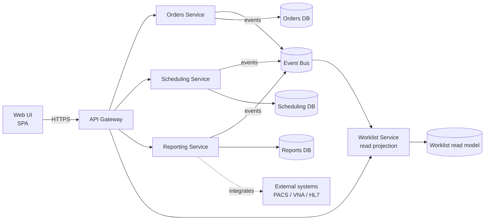

# MiniRIS — conceptual architecture (input for Part 2)

The runnable MiniRIS collapses everything into a single container so it is trivial to start.
The **real** system it stands in for is a set of services on a microservice platform
(containerized, orchestrated with Kubernetes). For the strategy part of the exercise, reason
about the conceptual architecture below rather than the single-container shortcut.

Notes for the candidate:

- **Write plane:** Orders, Scheduling, and Reporting own their data and emit events on state
  changes.
- **Read plane:** the Worklist service consumes those events and maintains a denormalised
  read model that powers the worklist query. This is the source of the eventual-consistency
  lag you will observe (`GET /api/orders`).
- **Integration boundary:** Reporting talks to external systems (PACS/VNA, HL7 feeds) that
  are out of scope to run here but matter when you think about test boundaries and what can
  realistically be automated versus stubbed.

You do not need to reproduce this topology. You need to reason about it: where automated
checks should live, what each layer is best suited to verify, what should be pushed left to
developers, and what a CI quality gate should enforce.
